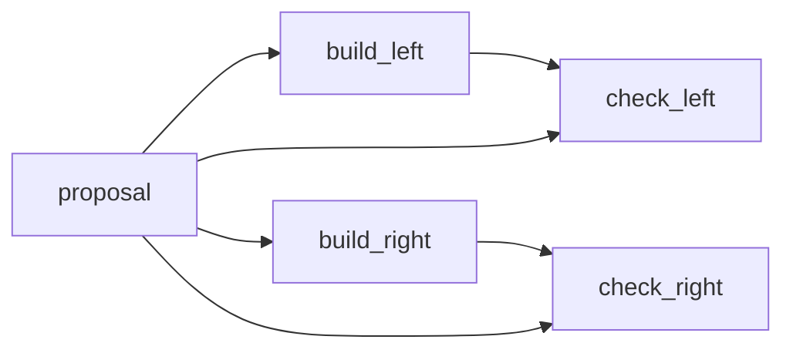

# One TESS proposal, two implementation branches

Use one proposal as the input to two separately declared implementation attempts.
Each attempt has its own validation step and storage. Preparing the source lets
you inspect those identities before choosing whether to launch.



The two validators each consume the proposal and their own implementation.
Branches execute serially after an explicit paid Launch. They do not promise
different scientific ideas or model quality. This lesson has no training, score,
aggregation, ranking or parallel execution.

## Copy and prepare

Prepare data using the [TESS guide](../README.md), then complete step 1 of the
[common project instructions](../../README.md) using a fresh external TESS project.
Keep the same task assets and data. Before step 2, select this lesson:

```bash
export PROFILE_FILE="examples/native_candidate/tess/fanout/profile.json"
```

Continue the common inspect → read facts → explicit accept steps. This selects
the [fanout profile](profile.json), creates one `workflow.py` and configures the
console project `tess_fanout`. Open the console, inspect all five nodes and their
connections, review/acknowledge/Save any edit, then **Prepare saved source**.
Preparing does not launch a candidate or load light-curve samples.

## Inspect the prepared result

**Open prepared run** identifies its inputs directory. Its parent,
`runs/<UUID>/`, is the run envelope. Look for:

- `inputs/proposal.json`: the single proposal input used by both branches.
- `inputs/storage.build_left.json` and `inputs/storage.build_right.json`: separate attempt
  destinations. Each validator shares only its own implementation's destination.
- `workflow.py.snapshot`: the exact source prepared for this run.

Change the copied `workflow.py` to edit branch names or supported advice, then
review again and create a fresh preparation. Keep earlier captures; source edits
do not rewrite them. Review the configured model routes, private credentials and
paid API effects in the common guide before any explicit Launch. The checks for this example cover editing and preparation; they do not run
the branches.

This lesson does not supply AND aggregation or comparison. For training and
scores, follow the [TESS training tutorial](../../../../tutorials/paper/tess/README.md)
with its matching pinned environment.
